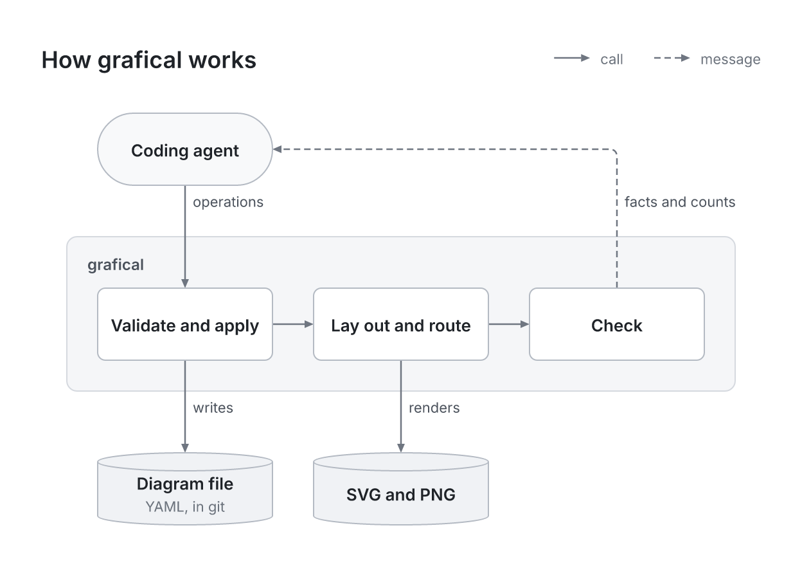
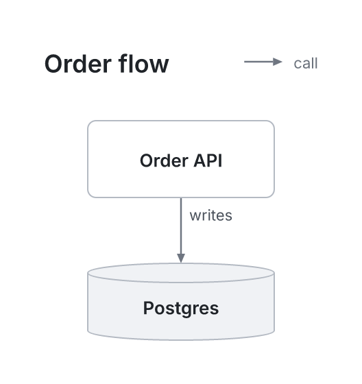
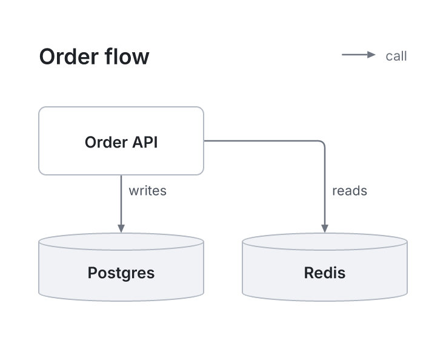

<!-- what-we-build: approved 2026-10-15 -->
# grafical

> Architecture diagrams that coding agents build in small, checked steps.

An agent states what a diagram says, one operation at a time: this box is in that row, connected to that one, colored like this. grafical decides where everything goes, and lays the picture out again after every change, so only what the agent named changes and the picture always looks finished. The agent never places a box or bends a line.



grafical drew this picture itself, from [`docs/images/pipeline.grafical.yaml`](docs/images/pipeline.grafical.yaml).

> **Status: in development, not yet released.** The command line works, and Haiku with grafical already draws as well as Opus with it. The MVP bar is not met yet: two blind judges scored Haiku's pictures 38 of 50, against a bar of 42. Where the work stands is in [ROADMAP.md](ROADMAP.md).

## What it does

- **Small steps.** Every change is one operation, such as `node add` or `edge add`, or a batch of them, all or nothing. A change moves only what it names.
- **The engine does the dirty work.** It sizes, places and spaces every box, routes every line, and checks every write for defects. A mistake is refused at once, with the facts to fix it.
- **Looks are free, places are facts.** An agent may pick any color or line width, and states a box's place as a row, a column or steps from another box, never a coordinate.
- **A file in git.** The diagram is one YAML file. The same file gives the same SVG and PNG on any machine, and `grafical diff` shows a change as operations.
- **Made for agents.** An agent learns grafical from `grafical --help`, and every reply is facts and counts, never advice.

[FEATURES.md](FEATURES.md) has every feature, and [PROPOSAL.md](PROPOSAL.md) has why grafical exists.

## Install

grafical is not on npm yet. It needs Node 24 or later and pnpm. Run it from a clone:

```sh
git clone https://github.com/jinhuang712/grafical.git
cd grafical
pnpm install
node src/cli/main.ts --help
```

## Use

An agent's prompt only has to say to draw with `grafical`. Here is what an agent does to draw a service and its database:

```sh
grafical new arch.grafical.yaml --title "Order flow"
grafical layer add arch.grafical.yaml app --label App
grafical layer add arch.grafical.yaml data --label Data
grafical node add arch.grafical.yaml api --label "Order API" --kind service --layer app
grafical node add arch.grafical.yaml db --label Postgres --kind store --layer data
grafical edge add arch.grafical.yaml api db --label writes
grafical render arch.grafical.yaml --png arch.png
```

Adding a cache later is two more steps, and the API and Postgres stay where they were:

```sh
grafical node add arch.grafical.yaml cache --label Redis --kind store --layer data --after db
grafical edge add arch.grafical.yaml api cache --label reads
```

| Before | After |
|---|---|
|  |  |

To watch an agent draw, open a window that redraws on every change:

```sh
grafical view arch.grafical.yaml
```

From a clone, write `node src/cli/main.ts` in place of `grafical`.

## Documents

- [PROPOSAL.md](PROPOSAL.md): why grafical exists, what it wants and what it won't do.
- [PHILOSOPHY.md](PHILOSOPHY.md): the questions grafical takes a stance on, and its answers.
- [DESIGN.md](DESIGN.md): how it is built, as principles and dated decisions.
- [GOALS.md](GOALS.md): the checks that say whether it works, each with its status.
- [FEATURES.md](FEATURES.md): what it does, and what it will and won't do.
- [ROADMAP.md](ROADMAP.md): what is done and what comes next.
- [EXPERIMENTS.md](EXPERIMENTS.md): how the benchmarks run, and the rules for a result.
- [AGENTS.md](AGENTS.md): how agents develop in this repository.
- [GITFLOW.md](GITFLOW.md): the git conventions.
- [TODO.md](TODO.md): small fixes and follow-ups with no milestone yet.
- [CHANGELOG.md](CHANGELOG.md): what changed in each release.

## License

[MIT](LICENSE).
