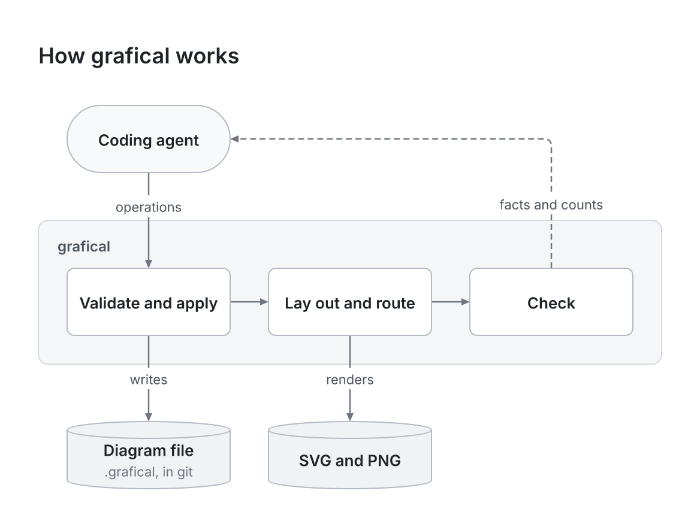
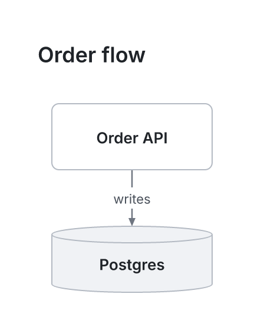
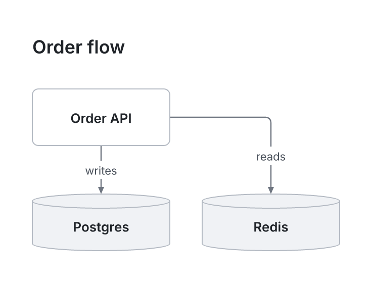

# grafical



> Architecture diagrams that coding agents build in small, checked steps.

[](https://github.com/jinhuang712/grafical/actions/workflows/ci.yml)
[](LICENSE)

An agent states what a diagram says, one operation at a time: this box is in that row, connected to that one, colored like this. grafical decides where everything goes and lays the picture out again after every change. **The agent never places a box or bends a line**, so only what it named changes and the picture always looks finished.

grafical drew the picture above itself, from [docs/images/pipeline.grafical.yaml](docs/images/pipeline.grafical.yaml).

## What it does

- 🪜 **Small steps:** every change is one operation, such as `node add` or `edge add`.
  - A batch applies many operations, all or nothing.
  - A change keeps every fact it does not name.
- ⚙️ **The engine does the dirty work:** it sizes and places and spaces every box.
  - It routes every line and checks every write for defects.
  - A mistake is refused at once, with the facts to fix it.
- 🎨 **Looks are free, places are facts:** an agent may pick any color or line width.
  - It states a box's place as a row or a column or steps from another box, never as a coordinate.
- 📁 **A file in git:** the diagram is one YAML file.
  - The same file gives the same SVG and PNG on any machine.
  - `grafical diff` shows a change as operations.
- 🤖 **Made for agents:** an agent learns grafical from `grafical --help`.
  - Every reply is facts and counts, never advice.

## Install

```sh
git clone https://github.com/jinhuang712/grafical.git && cd grafical && pnpm install
```

[INSTALL.md](INSTALL.md) has what it needs first and how to check it worked.

## How to use

An agent's prompt only has to say to draw with `grafical`. Here is what an agent does to draw a service and its database:

```sh
grafical new arch.grafical.yaml --title "Order flow"
grafical layer add arch.grafical.yaml app --label App
grafical layer add arch.grafical.yaml data --label Data
grafical node add arch.grafical.yaml api --label "Order API" --kind service --layer app
grafical node add arch.grafical.yaml db --label Postgres --kind store --layer data
grafical edge add arch.grafical.yaml api db --label writes
grafical render arch.grafical.yaml --png arch.png
```

Adding a cache later is two more steps, and the API and Postgres keep their rows and their order:

```sh
grafical node add arch.grafical.yaml cache --label Redis --kind store --layer data --after db
grafical edge add arch.grafical.yaml api cache --label reads
```

| Before | After |
|---|---|
|  |  |

To watch an agent draw, open a window that redraws on every change:

```sh
grafical view arch.grafical.yaml
```

> 💡 From a clone, write `node src/cli/main.ts` in place of `grafical`.

## Architecture

Every write runs the same parts, and only the agent's operations go in:

```text
agent ──command or batch──> command line ──records──> agent
                              │    └──writes──> diagram file (YAML, in git)
                              │ operations
                              ▼
                            model ── refusals ──> command line
                              │ facts
                              ▼
  text measurer ──> layout: placement ⇄ routing ──> text placement <── theme
                              │ laid-out picture
                              ├──> checker ── defects, warnings, counts ──> command line
                              └──> renderer ──> SVG ──> PNG
```

## Docs

- [PROPOSAL.md](PROPOSAL.md): why grafical exists and what it won't do.
- [PHILOSOPHY.md](PHILOSOPHY.md): the questions grafical takes a stance on.
- [DESIGNS.md](DESIGNS.md): what every design change must meet.
- [FEATURES.md](FEATURES.md): what it does and will and won't do.
- [plan/GOALS.md](plan/GOALS.md): the checks that say whether it works.
- [plan/ROADMAP.md](plan/ROADMAP.md): what is done and what comes next.
- [plan/TODO.md](plan/TODO.md): the open items with no checkpoint yet.
- [specs/ARCHITECTURE.md](specs/ARCHITECTURE.md): the parts and how they connect.
  - [specs/model.md](specs/model.md): the model.
  - [specs/file-formats.md](specs/file-formats.md): the file formats.
  - [specs/placement.md](specs/placement.md): placement.
  - [specs/routing.md](specs/routing.md): routing.
  - [specs/labels.md](specs/labels.md): text placement.
  - [specs/text.md](specs/text.md): the text measurer.
  - [specs/theme.md](specs/theme.md): the theme.
  - [specs/checks.md](specs/checks.md): the checker.
  - [specs/rendering.md](specs/rendering.md): the renderer.
  - [specs/answers.md](specs/answers.md): how grafical answers.
  - [specs/benchmark.md](specs/benchmark.md): how the benchmarks run.
- [specs/decisions](specs/decisions/README.md): each fork taken and what was not chosen.
- [GLOSSARY.md](GLOSSARY.md): one name for each thing.
- [INSTALL.md](INSTALL.md): how to install, update and remove it.
- [CHANGELOG.md](CHANGELOG.md): what changed in each release.
- [AGENTS.md](AGENTS.md): how agents develop in this repository.

## License

[MIT](LICENSE).
